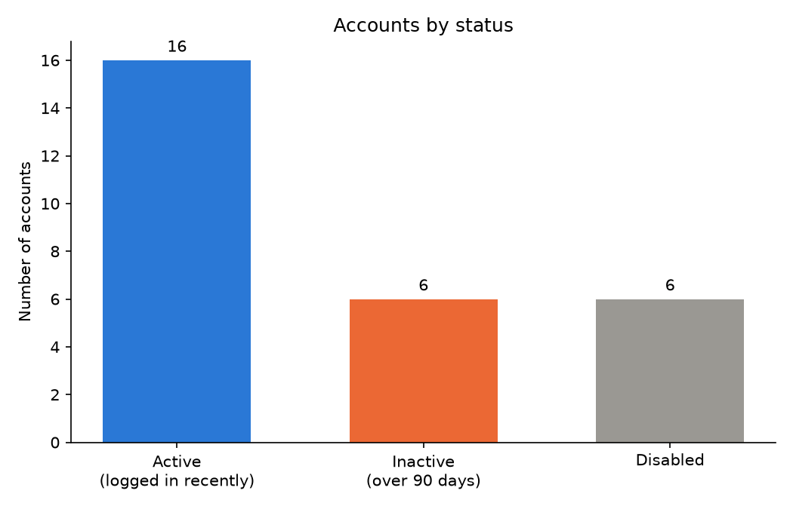
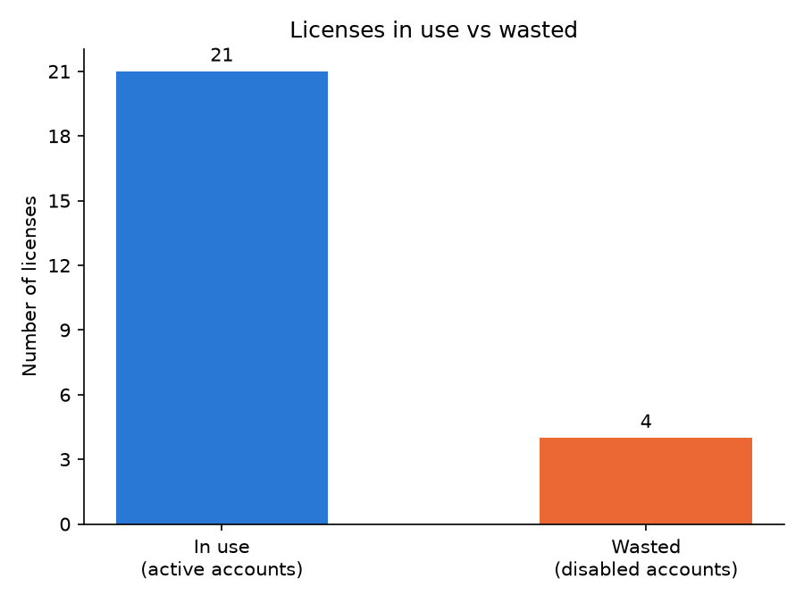

# Account & License Audit

A Python script that checks a list of user accounts for common clean-up problems and produces a report that IT staff can act on.

> All data in this project is made up. No real people or accounts are used.

[](https://colab.research.google.com/github/chloelauu/account-license-audit/blob/main/account_and_license_audit_demo.ipynb)

## Try it in your browser

No setup needed. Open the [live demo in Google Colab](https://colab.research.google.com/github/chloelauu/account-license-audit/blob/main/account_and_license_audit_demo.ipynb) to see the report, charts and cleaned list from a saved run.

To run it yourself, sign in with a Google account and click **Runtime**, then **Run all**.

## What it checks

| Check | Why it matters |
|---|---|
| **Inactive accounts.** Active accounts with no login for over 90 days | Unused accounts are a security risk and may be paying for licenses |
| **Duplicate emails.** The same email used on more than one account | Duplicates cause confusion and double-count users |
| **Wasted licenses.** Licenses still assigned to disabled accounts | These licenses can be taken back and reused |

## What it produces

After running, the `output/` folder contains:

| File | What it is |
|---|---|
| `cleaned_accounts.csv` | The account list with duplicates removed, licenses taken back from disabled accounts, and a `needs_review` column marking inactive accounts |
| `summary.txt` | A plain-text report listing every problem found |
| `chart_account_status.png` | Accounts by status |
| `chart_licenses.png` | Licenses in use vs wasted |

Inactive accounts are **flagged, not removed**, so a person can confirm before anyone loses access.

## Charts





## How to run it on your computer

You need [Python 3.12 or newer](https://www.python.org/downloads/).

1. Download this project and open a terminal in its folder.
2. Create a virtual environment and install the required packages:
   ```
   python -m venv .venv
   .venv\Scripts\activate
   pip install -r requirements.txt
   ```
   On Mac or Linux, use `source .venv/bin/activate` instead of the second line.
3. Run the report:
   ```
   python cleanup_report.py
   ```

The summary prints in the terminal and all files are saved to `output/`.

## Changing the rules

The settings are at the top of `cleanup_report.py`:

| Setting | What it controls |
|---|---|
| `REPORT_DATE` | The date the report counts from |
| `INACTIVE_DAYS` | How many days without a login counts as inactive (default 90) |
| `OUTPUT_DIR` | Where the results are saved |

To check your own account list, replace `data/accounts.csv` with a file that has the same columns:
`name, email, last_login, license, status`

## Built with

Python, pandas, Matplotlib, Git
